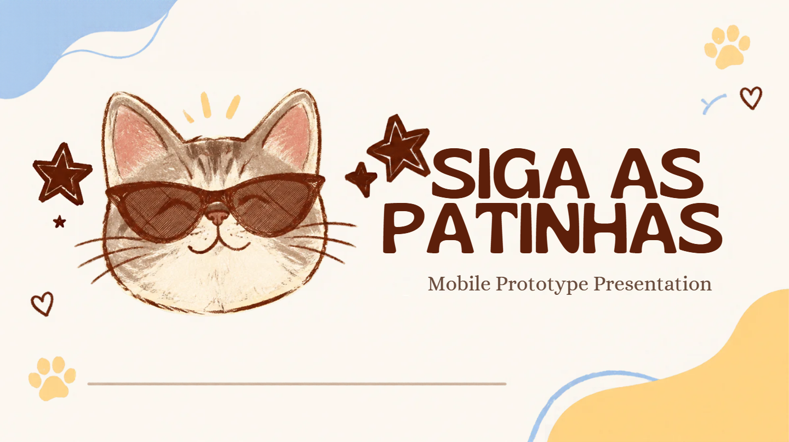
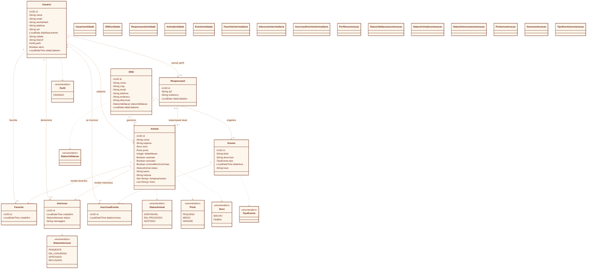

<!-- Salve a imagem de capa em docs/assets/capa.png para ela aparecer aqui -->

 

# 🐾 SIGA AS PATINHAS

### *Rastrear para cuidar: gestão pública e inclusiva de animais em situação de rua.*

 

[Sobre](#-sobre-o-projeto) •
[Problema](#-o-problema) •
[Funcionalidades](#-funcionalidades) •
[Arquitetura](#-modelagem-do-sistema) •
[Tecnologias](#-tecnologias-e-ferramentas) •
[Equipe](#-equipe) •
[Planejamento](#-planejamento)

---

## 📌 Sobre o projeto

O **Siga as Patinhas** é uma plataforma digital criada para facilitar a **identificação, o acompanhamento e a proteção** de animais em situação de vulnerabilidade.

A proposta é **conectar cidadãos, ONGs, cuidadores e órgãos públicos**, promovendo uma gestão mais organizada, transparente e eficiente das informações relacionadas aos animais.

> 🧡 *Cada patinha registrada é um passo a mais rumo a um cuidado de verdade.*

---

## 🚨 O problema

Animais em situação de rua enfrentam diariamente:

- 🐶 **Abandono** e falta de um lar;
- 💉 **Ausência de cuidados veterinários**, como vacinação e castração;
- 🔎 **Dificuldade de identificação** e de acompanhamento ao longo do tempo;
- 🗂️ **Informações dispersas**, que dificultam o trabalho de quem atua na proteção animal.

## 🎯 Objetivo

Desenvolver uma plataforma que facilite o **registro e o acompanhamento dos animais**, reunindo informações importantes em um único lugar e aproximando a população dos serviços de proteção animal.

---

## 👥 Público-alvo

| | Perfil | Como a plataforma ajuda |
|:-:|---|---|
| 🙋 | **Cidadãos** | Registrar animais, denunciar maus-tratos e adotar |
| 🏠 | **ONGs e instituições** | Gerenciar animais e divulgar ações |
| 💛 | **Cuidadores e protetores independentes** | Acompanhar o histórico e os cuidados de cada animal |
| 🏛️ | **Órgãos públicos** | Obter dados organizados para uma gestão eficiente |

---

## ⚙️ Funcionalidades

| Funcionalidade | Descrição |
|---|---|
| 🔐 **Cadastro e login** | Acesso seguro dos usuários à plataforma |
| 🏷️ **Identificação dos animais** | Registro de informações para reconhecimento e acompanhamento |
| 🔔 **Notificações** | Comunicação de informações importantes |
| 📋 **Histórico do animal** | Vacinação, castração e outros cuidados |
| 🐕 **Adoção** | Cadastro, consulta e busca de animais disponíveis |
| 📢 **Denúncias** | Registro de situações de abandono e maus-tratos |
| 📰 **Eventos e notícias** | Divulgação de ações e conteúdos sobre proteção animal |
| 💬 **Suporte** | Perguntas frequentes e canais de contato |

---

## 🧩 Modelagem do sistema

## 🛠️ Modelagem do sistema

### 📊 Diagrama de Classes

O diagrama abaixo representa a estrutura principal do sistema **Siga as Patinhas**, apresentando as entidades, seus atributos, enumerações e os relacionamentos entre elas.

### 🎨 Legenda

| Cor | Representação |
|---|---|
| 🟫 Creme | Entidades principais do sistema |
| 🟨 Amarelo | Entidades/tabelas intermediárias utilizadas nos relacionamentos |
| 🟦 Azul | Enumerações (Enums) |

### 🔗 Relacionamentos

- **Usuário e Responsável:** um usuário pode possuir um perfil de responsável.
- **Usuário e Animal:** um usuário pode cadastrar vários animais.
- **ONG e Animal:** uma ONG pode gerenciar vários animais.
- **Responsável e Animal:** um responsável pode estar associado aos animais sob sua responsabilidade.
- **ONG e Evento:** uma ONG pode organizar vários eventos.
- **Usuário e Favorito:** um usuário pode favoritar vários animais.
- **Animal e Favorito:** um animal pode receber vários favoritos.
- **Usuário e Interesse:** um usuário pode demonstrar interesse em vários animais.
- **Animal e Interesse:** um animal pode receber vários registros de interesse.
- **Usuário e Inscrição em Evento:** um usuário pode se inscrever em vários eventos.
- **Evento e Inscrição:** um evento pode receber várias inscrições.

---

## 🛠️ Tecnologias e ferramentas

| Categoria | Ferramentas |
|---|---|
| 🎨 **Frontend** | React · Vite · TypeScript |
| ⚙️ **Backend** | Java |
| 💻 **IDEs** | Eclipse · IntelliJ IDEA · VS Code |
| 🔀 **Versionamento** | Git · GitHub |
| 📌 **Organização** | Trello |
| 🖌️ **Prototipação** | Figma |

---

## 👩‍💻 Equipe

<table>
  <tr>
    <th align="center">🎨 UX / Documentação</th>
    <th align="center">🖥️ Frontend</th>
    <th align="center">🧠 Backend</th>
  </tr>
  <tr>
    <td align="center">
      Tarcilla Maria 
      Bruna Francisca 
      Antônio Henrique
    </td>
    <td align="center">
      Luísa Geórgia 
      Mayara Eduarda 
      Maria Gabriella
    </td>
    <td align="center">
      Kamyla Vitória 
      Thamires Vitória 
      Thais Vitória
    </td>
  </tr>
  <tr>
    <td align="center">Documentação, organização das informações e revisão da interface e da experiência do usuário.</td>
    <td align="center">Desenvolvimento das telas e da interface da plataforma.</td>
    <td align="center">Desenvolvimento do backend, gerenciamento de dados e regras de negócio.</td>
  </tr>
</table>

---

## 📅 Planejamento

O projeto está organizado em **cinco semanas**, contemplando:

`Planejamento` → `Desenvolvimento` → `Integração` → `Testes` → `Entrega`

## 📦 Entregas esperadas

- ✅ Plataforma digital **Siga as Patinhas**;
- ✅ Interface com as funcionalidades propostas;
- ✅ Sistema de registro e acompanhamento dos animais;
- ✅ Documentação do projeto.

## 🌱 Impacto esperado

Contribuir para a proteção animal por meio da tecnologia, facilitando o acesso às informações, incentivando a participação da população e apoiando o trabalho de instituições e órgãos responsáveis.

---

🐾 *Projeto acadêmico, Análise e Desenvolvimento de Sistemas* 🐾

Feito com 🧡 por quem acredita que todo bichinho merece cuidado.

